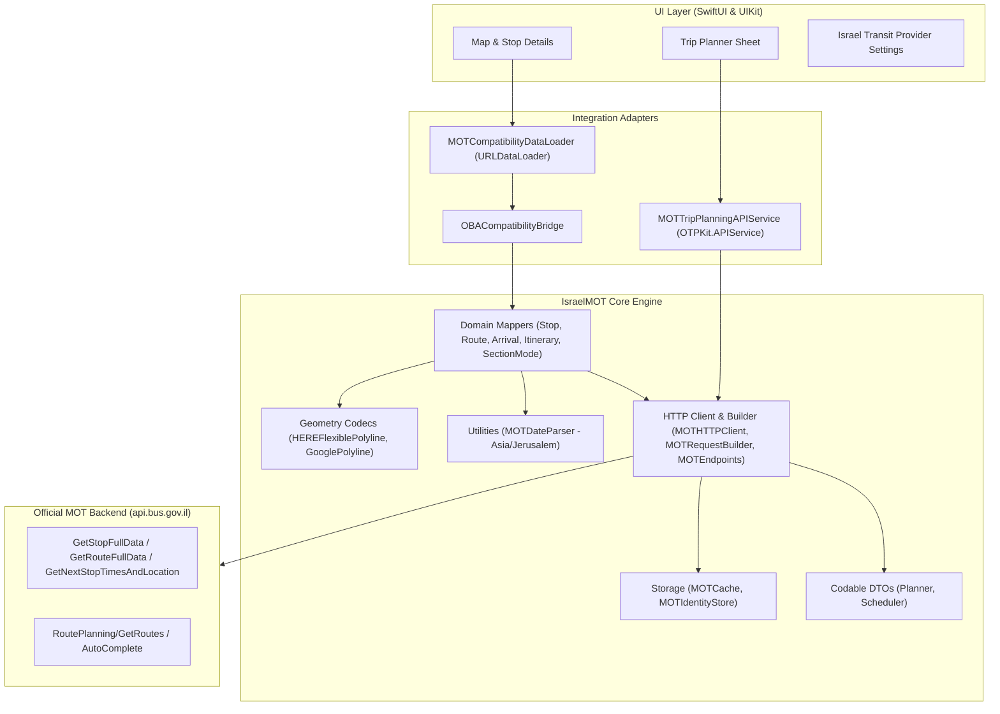

# Israel MOT Transit Adapter - Architecture & System Design

## 1. Executive Overview

The **Israel MOT Transit Adapter** (`IsraelMOT`) integrates the official Israeli Ministry of Transport (MOT / משרד התחבורה) public transit backend (`api.bus.gov.il`) into the **OneBusAway iOS** ecosystem.

### Architectural Philosophy
1. **Strict Upstream Isolation**: The adapter lives in a dedicated module (`IsraelMOT/`). The core OneBusAway code retains its original architecture and behavior, with surgical, minimal seams.
2. **Zero Regression for Global Regions**: All existing regions (Puget Sound, Tampa, Atlanta, San Diego, Rogue Valley, etc.) execute standard OneBusAway REST and OTP pathways without any modification or interference.
3. **Truthful & Transparent API Integration**: Public endpoints operate live with official request contracts and verified header profiles. Real-time predictions reflect true SIRI tracking without artificial time offsets or invented GPS markers.
4. **First-Class Hebrew Localization & RTL Support**: Complete parity across all app targets, extensions, widgets, and watchOS components.

---

## 2. Layered Architecture

---

## 3. Module Boundaries & Components

### 3.1 Contracts (`IsraelMOT/Contracts/`)
- `Identifiers.swift`: Strongly-typed wrappers for Israel transit IDs (`MOTStopCode`, `MOTStopInternalID`, `MOTRouteID`, `MOTRouteDesc`, `MOTAgencyID`) and formatting utilities (`MOTIdentityFormatter` producing `mot:stop:<code>`, `mot:route:<id>`).
- `TransitDomainModels.swift`: Clean Swift models decoupled from external networking schemas (`TransitStop`, `TransitRoute`, `TransitArrival`, `TransitMultiLanguageName`).

### 3.2 Geometry & Time Codecs
- `HEREFlexiblePolylineDecoder.swift`: Decodes HERE Flexible Polyline v1 (variable precision: 6 for walk, 7 for transit) into `[CLLocationCoordinate2D]`.
- `GooglePolylineEncoder.swift`: Standard Google 5-decimal polyline encoder/decoder for OTPKit and MapKit.
- `MOTDateParser.swift`: Parses Israel wall-clock timestamps (`yyyy-MM-dd'T'HH:mm:ss`) in `Asia/Jerusalem` timezone with DST support. Never returns `Date()` fallback on failure.

### 3.3 HTTP & Request Building (`IsraelMOT/Core/HTTP/`)
- `MOTRequestBuilder.swift`: Centralizes headers for Planner (`Origin: https://route.bus.gov.il`) and Scheduler (`Origin: https://bus.gov.il`).
- `MOTHTTPClient.swift`: Structured URLSession executor, retry policy with exponential backoff and jitter, non-retryable 403 policy, F5 support ID extraction.

### 3.4 Adapters & Mappers
- `MOTItineraryMapper.swift`: Maps 6 alternatives, 24 sections, 87 walking actions, transit transfers (`max(transitLegCount - 1, 0)`), and HERE geometry to OTPKit.
- `MOTArrivalsMapper.swift`: Truthfully maps scheduled timetable departures and SIRI live GPS predictions without placeholder defaults.
- `MOTCompatibilityDataLoader.swift`: Intercepts OBA REST requests for Region 972 and synthesizes standard OneBusAway REST JSON envelopes.
