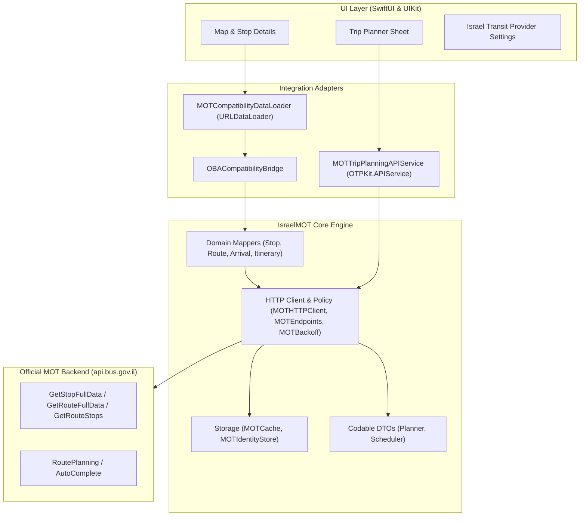

# Israel MOT Transit Adapter - Architecture & System Design

## 1. Executive Overview

The **Israel MOT Transit Adapter** (`IsraelMOT`) integrates the official Israeli Ministry of Transport (MOT / משרד התחבורה) public transit backend (`api.bus.gov.il`) into the **OneBusAway iOS** ecosystem.

### Architectural Philosophy
1. **Strict Upstream Isolation**: The adapter lives in a dedicated module (`IsraelMOT/`). The core OneBusAway code retains its original architecture and behavior, with surgical, minimal seams.
2. **Zero Regression for Global Regions**: All existing regions (Puget Sound, Tampa, Atlanta, San Diego, Rogue Valley, etc.) execute standard OneBusAway REST and OTP pathways without any modification or interference.
3. **Truthful & Transparent API Integration**: Public GET endpoints (stops, routes, locations) operate live. Endpoints protected by F5 Distributed Cloud (Volt ADC) WAF (such as POST route planning) fail gracefully with structured, user-facing error reporting rather than fragile bypasses or bot scraping.
4. **First-Class Hebrew Localization & RTL Support**: Complete parity across all app targets, extensions, widgets, and watchOS components.

---

## 2. Layered Architecture



---

## 3. Module Boundaries & Components

### 3.1 Contracts (`IsraelMOT/Contracts/`)
- `Identifiers.swift`: Strongly-typed wrappers for Israel transit IDs (`MOTStopCode`, `MOTStopInternalID`, `MOTRouteID`, `MOTRouteDesc`, `MOTAgencyID`) and formatting utilities (`MOTIdentityFormatter` producing `mot:stop:<code`, `mot:route:<id>`).
- `TransitDomainModels.swift`: Clean Swift models decoupled from external networking schemas (`TransitStop`, `TransitRoute`, `TransitArrival`, `TransitMultiLanguageName`).
- `MOTFeatureCapabilities.swift`: Declarative capability flags indicating supported features (Real-time arrivals: Yes, Offline maps: No, Trip planning: WAF-constrained).

### 3.2 Core HTTP & Networking (`IsraelMOT/Core/HTTP/`)
- `MOTHTTPClient`: Actor-isolated resilient HTTP client.
- `MOTEndpoints`: URL factory for all MOT OpenAPI endpoints (`api.bus.gov.il/prod/...`).
- `MOTRequestPolicy`: Timeout, retry count, and security header policies.
- `MOTBackoff`: Exponential backoff with decorrelated jitter.
- `MOTHTTPError`: Structured errors covering WAF blocks (with F5 support ID extraction), rate limits (HTTP 429), server errors (HTTP 503), and decoding failures.

### 3.3 Core DTOs (`IsraelMOT/Core/DTO/`)
- `Scheduler/`:
  - `StopFullDataResponseDTO`: Complete stop info, routes in stop, platform number.
  - `RouteFullDataResponseDTO`: Route line name, agency name, geometry polyline.
  - `NextStopDataDTO`: Live countdowns and real-time vehicle GPS positions.
- `Planner/`:
  - `LocationAutoCompleteDTO`: Places, stops, and geographic suggestions.
  - `GetRoutesRequestDTO` & `RouteResponseDTO`: Multi-modal itinerary solutions and transit legs.

### 3.4 Core Mappers (`IsraelMOT/Core/Mappers/`)
- `MOTStopMapper`: Transforms MOT stop DTOs into OneBusAway `OBAKitCore.Stop` models.
- `MOTRouteMapper`: Transforms MOT route DTOs into `OBAKitCore.Route` models.
- `MOTArrivalsMapper`: Blends scheduled route timetables with real-time SIRI vehicle positions into `ArrivalDeparture` models.
- `MOTLegGeometryMapper`: Encodes and decodes Google polyline geometries with straight-line fallback.
- `MOTItineraryMapper`: Translates MOT itinerary solutions into OTPKit `Plan` and `Leg` structures.

### 3.5 OBA & OTP Adapters (`IsraelMOT/OBAAdapter/` & `OTPAdapter/`)
- `MOTCompatibilityDataLoader`: Intercepts REST requests targeting `api/where/...` when Region 972 is active, querying MOT APIs and wrapping results into standard OBA REST JSON envelopes (`OBACompatibilityBridge`).
- `MOTTripPlanningAPIService`: Conforms to OTPKit's `APIService` protocol, dispatching planning requests to MOT's trip planner and reporting WAF barriers transparently.

---

## 4. Upstream Seam Design

To avoid tightly coupling `IsraelMOT` into `OBAKitCore` (which does not depend on OTPKit or IsraelMOT):
1. **Dynamic DataLoader Seam**:
   - `CoreApplication.swift` exposes:
     ```swift
     open func dataLoader(for region: Region) -> URLDataLoader {
         return config.dataLoader
     }
     ```
   - In `OBAKit.Application`, this hook is overridden:
     ```swift
     open override func dataLoader(for region: Region) -> URLDataLoader {
         if region.regionIdentifier == 972 {
             return MOTCompatibilityDataLoader(fallbackLoader: super.dataLoader(for: region))
         }
         return super.dataLoader(for: region)
     }
     ```
2. **Trip Planner Injection**:
   - In `TripPlannerSheetView.swift` and `MapViewController+TripPlanner.swift`, when `region.regionIdentifier == 972`, `MOTTripPlanningAPIService` is injected.

This design guarantees that if Region 972 is not active, execution takes the upstream path with zero performance or logic overhead.
