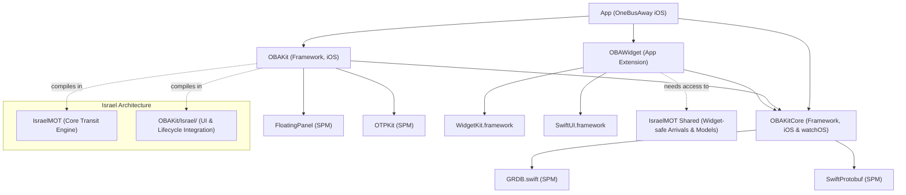

# Dependency Graph & Target Architecture Audit

**Branch:** `fix/israel-extraction-and-repair-20261027`  
**Target:** `OneBusAway.xcodeproj` / `OBAKit.xcodeproj`  

---

## 1. Target Membership & Hierarchy

The OneBusAway workspace is generated using XcodeGen across multiple modular `project.yml` definitions:

### Key Architectural Constraints:
1. **`OBAWidget` App Extension Safety:**
   - `OBAWidget` is an iOS App Extension with `APPLICATION_EXTENSION_API_ONLY: true`.
   - `OBAWidget` depends **only** on `OBAKitCore`, `WidgetKit`, and `SwiftUI`.
   - `OBAWidget` **cannot link `OBAKit`** because `OBAKit` contains UIKit view controllers, application singletons (`Application.shared`), and UIAppearance code forbidden in extensions.
   - Therefore, any Israeli code executed by the widget (`IsraelWidgetArrivalsClient`, `MOTEndpoints`, `MOTArrivalsMapper`, DTOs) must **never** depend on `OBAKit` or `UIKit`.

2. **`OBAKitCore` Independence:**
   - `OBAKitCore` is a shared framework for iOS and watchOS.
   - It must remain clean of high-level regional dependencies and UIKit.
   - It provides generic extension points: `open func dataLoader(for region: Region) -> URLDataLoader` in `CoreApplication`.

3. **`IsraelMOT` Target Integration:**
   - Currently, `IsraelMOT` source files are included as a synced folder in `OBAKit/project.yml`:
     `- path: ../IsraelMOT` (excluding Tests, Scripts, Docs, Resources).
   - In `IsraelMOT`, only `MOTAgencyColorResolver.swift` referenced `UIKit` (wrapped in `#if canImport(UIKit)`).
   - To enable widget arrivals loading without duplicate symbol conflicts or introducing circular dependencies:
     - `IsraelMOT` core networking, DTOs, mappers, and `IsraelWidgetArrivalsClient` are kept strictly UI-free and safe for extension use.
     - Sources can be compiled cleanly or linked without UIKit overhead.

---

## 2. Import Graphs & Seam Analysis

### A. Upstream Seam Points
1. **Networking (`CoreApplication` & `RESTAPIService`):**
   - Hook: `CoreApplication.dataLoader(for: region) -> URLDataLoader`.
   - Subclassed in `Application.swift`: returns `MOTCompatibilityDataLoader` when `regionIdentifier == 972` and provider is active.
   - Widget Seam: `WidgetDataProvider` checks `if region.regionIdentifier == 972` and uses `IsraelWidgetArrivalsClient` (or `MOTCompatibilityDataLoader`), ensuring non-972 uses standard `RESTAPIService.standalone`.

2. **Map Viewport Routes & Vehicles:**
   - Hook: `MapLayerRegistrar.swift` & `MapViewController+MapLayers.swift`.
   - SwiftUI Hook: `MapPanelRootView.swift` hosts `IsraelNearbyRoutesMapOverlay` when active region is 972.
   - Separation of State: `IsraelViewportRouteRepository` owns caching, spatial bounding box queries, route deduplication, and vehicle tracking.

3. **Selected Route & Timeline:**
   - Hook: `AppSheetViewFactory.swift` in `routeStops` sheet creation.
   - If region is 972: renders `IsraelRouteStopsTimelineView` with vertical timeline and sequence progress.
   - Canonical navigation preserved: calls `displayModel.focus(coordinate:)` and `coordinator.push(.stopDetails(stopID:))`.

4. **Live Activities:**
   - Single Entry Point: `IsraelActivityLifecycleService.shared`.
   - Initialized reliably during app launch / services bootstrap.
   - Called identically from `StopPageActionPresenter`, `TripPageViewController`, and `BookmarkActions`.
   - Coordinates with `IsraelTripBackgroundTrackingCoordinator` without cyclic memory leaks.

---

## 3. Storage, Cache Keys & App Group Safety

- **App Group Identifier:** `group.org.onebusaway.iphone`
- **Shared Containers:**
  - `UserDefaults(suiteName: "group.org.onebusaway.iphone")`
  - Stores: bookmarks, resolved region (`ResolvedRegionStore`), client UUID.
- **Cache Isolation:**
  - All Israeli caches (stop catalog, route shape cache, arrivals cache) are scoped by `regionIdentifier: 972` and provider ID.
  - No risk of corrupting non-Israel bookmarks or region data.

---

## 4. Lifecycle Ownership, Concurrency & Cancellation

1. **Map Loading:**
   - Viewport updates debounce for 300ms.
   - Prior `Task` is explicitly cancelled on new viewport changes.
   - Existing valid polylines and vehicles are retained in memory during loading (no transient flickering or blanking).
2. **Selected Route Vehicles:**
   - `IsraelSelectedRouteSession` owns the live vehicle feed for the selected route.
   - Scope is tied to sheet navigation lifecycle: cancelled when route sheet is dismissed.
3. **Live Activities:**
   - Background tracking uses location services with strict throttling (minimum 25s / 100m) and 2-hour failsafe ceiling to prevent battery drain.
