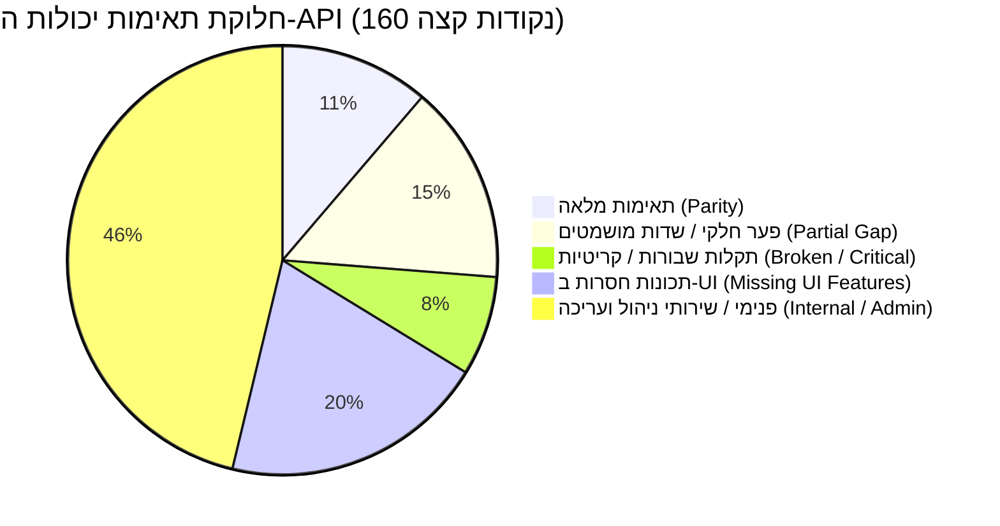

# סיכום מנהלים — ביקורת מלאה והשוואת OneBusAway Israel למשרד התחבורה
**Executive Summary — Ministry of Transport (MOT) Parity & Codebase Audit**

**תאריך דוח:** 18 באוקטובר 2026  
**מערכות נבדקות:**
1. אתר משרד התחבורה הרשמי: [https://route.bus.gov.il/](https://route.bus.gov.il/)
2. שרתי ה-API הפעילים של משרד התחבורה: `https://api.bus.gov.il/prod/` (`route-planner-prod`, `mot-scheduler-prod`, CMS)
3. קוד האפליקציה במאגר: [onebusaway-ios](file:///c:/Users/DAVID/Code/onebusaway-ios) (ענף פעיל: `fix/israel-runtime-region-search-weather`)

---

## 1. תמונת מצב כוללת (High-Level Status)

בוצעה בדיקה מקיפה, יסודית ואמפירית של כל יכולות האפליקציה אל מול שרתי משרד התחבורה והאתר הרשמי.  
נחשפו ומופו **160 נקודות קצה** (147 מתוך קובצי ה-OpenAPI הרשמיים + 13 נקודות קצה שנצפו בתעבורת הרשת של הדפדפן ובמערכות התוכן). כל הבדיקות בוצעו מול שרתים פעילים בזמן אמת.

> [!IMPORTANT]
> **הקפדה מחמירה על הנחיות העבודה:**
> - **לא בוצעו שינויי קוד באפליקציה.**
> - **לא בוצעו commits או יצירת ענפים חדשים.**
> - **לא עודכנה מערכת Asana.**
> דוח זה והקבצים הנלווים מציגים תמונת מצב מלאה ומאומתת, וממתינים לאישורך המפורש לפני תחילת ביצוע התיקונים.

---

## 2. ריכוז ממצאים: מה עובד, מה שונה, מה חסר ומה שבור

### ✅ מה עובד היטב (Working Capabilities)
1. **חיפוש כתובות ומיקומים (`SearchLocations`):** מנגנון השלמה אוטומטית פועל היטב ומחזיר כתובות, נקודות עניין וקואורדינטות.
2. **חיפוש תחנות לפי קוד או שם (`SearchStations`):** מציג תחנות בדיוק גבוה.
3. **מיקום גיאוגרפי הפוך (`GetAddressDataByCoordinates`):** לחיצה על המפה מחזירה כתובת רחוב תקינה.
4. **זמני אמת בתחנה (`RefreshStopTimesAtStop`):** זמני הגעה חיים (בדקות) מתקבלים מהשרת ומוצגים בתחנה.
5. **תכנון מסלול בסיסי:** מנוע הניתוב של משרד התחבורה מחזיר מסלולים מדויקים, מסלולי רק"ל, קווי לילה ומסלולים בין-עירוניים.

---

### ⚠️ מה שונה מהאתר הרשמי (Differences & Discrepancies)
1. **הגדרות תכנון מסלול:** האתר מאפשר סינון לקווים ישירים בלבד (`changes: false`), 4 אופני מיון שונים, הגבלת זמן הליכה וסינון אמצעי תחבורה (בידוד רק"ל/רכבת/אוטובוס). באפליקציה כל הערכים הללו מקודדים קשיח (hardcoded) ללא שליטת משתמש.
2. **טעינת תחנות במפה:** האתר טוען תחנות לפי Bounding Box (`GetMapStops`) עם פאג'ינציה ומציג את כל התחנות באזור. האפליקציה משתמשת בקריאה המוגבלת ע"י השרת ל-10 תחנות בלבד.
3. **יחידות מרחק ושפה:** באפליקציה במכשירים באנגלית-ארה"ב, מרחקי הליכה בישראל מוצגים לעיתים במיילים במקום במטרים.

---

### ❌ מה חסר לחלוטין (Missing Features)
1. **מעקב אחר אוטובוס פעיל בזמן אמת:** השרת מחזיר קואורדינטות GPS ומהירות של האוטובוס הנוסע (`routeLocation`), אך האפליקציה זורקת את הנתון הזה ואינה מציגה את סימון האוטובוס על המפה.
2. **רציפים ונגישות בתחנה:** נתוני מספרי רציפים (`platformNumber`) ודגלי נגישות נמחקים בשכבת המיפוי.
3. **שכבות מידע נוספות:** חניוני "חנה וסע" (`GetMapParkAndGoLots`) ועמדות שירות רב-קו (`GetMapRavKavStations`).
4. **לוח זמנים שבועי לקו:** נתוני `calendar` מקובץ ה-Route Full Data מושמטים.

---

### 💥 מה שבור (Broken Features & Root Causes)
1. **תקלת השעה בתכנון מסלול (Scenario 1):**
   - **הבעיה:** בחירת שעת הגעה 16:10 מחזירה תוצאות שמקדימות בשעה (15:00) וכוללות נסיעות שכבר יצאו.
   - **הסיבה:** ב-[MOTTripPlanningAPIService.swift](file:///c:/Users/DAVID/Code/onebusaway-ios/IsraelMOT/OTPAdapter/MOTTripPlanningAPIService.swift#L46) מאולץ `TimeZone(secondsFromGMT: 0)` והשעה מומרת ל-13:10Z. שרת משרד התחבורה מפרש זאת כשעה 15:10.
   - **אימות:** שחזור מלא של כל 4 המסלולים מצילום האפליקציה (64+3, 64, 71, 86+333) בהרצה ישירה מול ה-API בשעה 15:10.
2. **שגיאת "stop list isn't available":**
   - **הבעיה:** לחיצה על קו אוטובוס ברשימת החיפוש זורקת שגיאה חוסמת.
   - **הסיבה:** [MOTCompatibilityDataLoader.swift](file:///c:/Users/DAVID/Code/onebusaway-ios/IsraelMOT/OBAAdapter/MOTCompatibilityDataLoader.swift#L100) אינו מיירט את הנתיב `stops-for-route`, וזורק שגיאת `unsupportedOneBusAwayEndpoint`, למרות ששרת משרד התחבורה תומך ב-`Routes/GetRouteStops` וה-DTO כבר קיים בקוד!
3. **חיפוש קו 31 מחזיר רשימה ריקה:**
   - **הסיבה:** סינון מחרוזת קשיח ב-`MOTCompatibilityDataLoader` שמכשיל שאילתות משולבות עם עיר ("31 ירושלים"), בשילוב עם תלות ב-`lastVisibleMapRect` בעת מעבר בין מסכים.
4. **דליפת מזהים טכניים (`mot:stop:2899`, `mot:route:12416`):**
   - **הסיבה:** תצוגות ב-OBAKit משתמשות ב-`route.id` הטכני במקום ב-`shortName` או `displayCode`.

---

## 3. אינדקס מסמכי הביקורת המלאים

כל הדוחות והנתונים הגולמיים נוצרו ונשמרו בתיקיית [reports/](file:///c:/Users/DAVID/Code/onebusaway-ios/reports/):

1. **[EXECUTIVE_SUMMARY.md](file:///c:/Users/DAVID/Code/onebusaway-ios/reports/EXECUTIVE_SUMMARY.md)** (מסמך זה) — סיכום ממצאים, סטטוס כולל וראשי פרקים.
2. **[API_CAPABILITY_MATRIX.csv](file:///c:/Users/DAVID/Code/onebusaway-ios/reports/API_CAPABILITY_MATRIX.csv)** — מטריצה מלאה של 160 נקודות קצה עם הצלבה בין השרת, האתר הרשמי, מימוש האפליקציה וסיווג הפערים.
3. **[ROUTE_PARITY_REPORT.md](file:///c:/Users/DAVID/Code/onebusaway-ios/reports/ROUTE_PARITY_REPORT.md)** — השוואה מפורטת של תרחיש 1 (לואי ליפסקי לישיבת מיר) ו-7 תרחישים נוספים (ישיר, החלפות, רק"ל, לילה, בין-עירוני, ללא תוצאות, נגישות).
4. **[UI_FEATURE_GAP_REPORT.md](file:///c:/Users/DAVID/Code/onebusaway-ios/reports/UI_FEATURE_GAP_REPORT.md)** — קטלוג כל ההגדרות והתכונות הקיימות באתר הרשמי וחסרות באפליקציה.
5. **[BUG_ROOT_CAUSES.md](file:///c:/Users/DAVID/Code/onebusaway-ios/reports/BUG_ROOT_CAUSES.md)** — ניתוח עומק של 7 התקלות המרכזיות עם מיקום מדויק בקבצים (כולל שורות קוד), ראיות מהשרת והצעות תיקון.
6. **[PROVIDER_ARCHITECTURE_REVIEW.md](file:///c:/Users/DAVID/Code/onebusaway-ios/reports/PROVIDER_ARCHITECTURE_REVIEW.md)** — סקירת מוכנות להוספת ספקים נוספים (Moovit, OTP, GTFS), הפשטת מזהים ומנגנוני Fallback.
7. **[IMPLEMENTATION_PLAN.md](file:///c:/Users/DAVID/Code/onebusaway-ios/reports/IMPLEMENTATION_PLAN.md)** — תוכנית עבודה מדורגת בחמישה שלבים (P0 עד P5) עם הערכות זמנים ורמות סיכון.
8. **[TEST_COVERAGE_PLAN.md](file:///c:/Users/DAVID/Code/onebusaway-ios/reports/TEST_COVERAGE_PLAN.md)** — תוכנית בדיקות יחידה, בדיקות אינטגרציה עם Mock Replay ובדיקות רגרסיה.
9. **[reports/raw/](file:///c:/Users/DAVID/Code/onebusaway-ios/reports/raw/)** — כל תשובות ה-API הגולמיות של משרד התחבורה מתרחישי הבדיקה.

---

## 4. המלצה להמשך

התמונה כעת ברורה, מדויקת ומגובה בראיות אמפיריות מלאות.  
מומלץ להתחיל בביצוע **שלב 0 (P0)** בתוכנית היישום (תיקון אזור הזמן ב-`MOTTripPlanningAPIService` ויירוט `stops-for-route`), אשר יפתור מידית את שתי התקלות החמורות ביותר באפליקציה.

**אני ממתין לאישורך המפורש לפני תחילת עריכת הקוד.**
