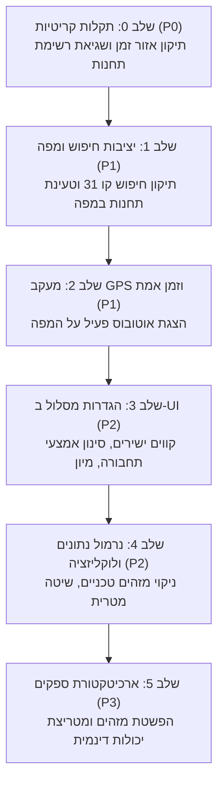

# תוכנית יישום ותיקון מדורגת — Phased Implementation Plan
**תאריך:** 18 באוקטובר 2026  
**מטרה:** תיקון כלל התקלות המזוהות, השגת תאימות (Parity) מלאה מול אתר משרד התחבורה, והשלמת חוויית המשתמש באפליקציית OneBusAway Israel.  
**כלל ברזל:** אין לבצע שינויי קוד, commits או עדכוני Asana לפני אישור מפורש של תוכנית זו על ידי המשתמש.

---

## מפת שלבי העבודה (Roadmap Overview)

---

## שלב 0: תיקון תקלות קריטיות (P0 — Immediate Blockers)

### 0.1 תיקון שגיאת אזור הזמן בתכנון מסלול (Timezone Shift)
- **יעד:** הבטחה ששעת היעד שנבחרה באפליקציה (לדוגמה 16:10) תתקבל בשרת כשעה מקומית ישראלית מלאה, ולא תוקדם ב-1–3 שעות.
- **קבצים לעריכה:**
  - [IsraelMOT/OTPAdapter/MOTTripPlanningAPIService.swift](file:///c:/Users/DAVID/Code/onebusaway-ios/IsraelMOT/OTPAdapter/MOTTripPlanningAPIService.swift#L44-L65)
- **פעולות נדרשות:**
  1. שינוי ה-`isoFormatter` כך שישתמש ב-`TimeZone(identifier: "Asia/Jerusalem") ?? .current` ובפורמט `"yyyy-MM-dd'T'HH:mm:ss"`.
  2. הסרת האילוץ של סיומת 'Z' (GMT).
- **בדיקת אימות:** הרצת תרחיש לואי ליפסקי 39 לישיבת מיר עם שעה 16:10 ואימות שהמסלולים מגיעים בין 15:55 ל-16:08.

### 0.2 פתרון שגיאת "stop list isn't available" בבחירת קו
- **יעד:** אפשור הצגת רשימת התחנות המלאה ומסלול הקו במפה בלחיצה על תוצאת חיפוש.
- **קבצים לעריכה:**
  - [IsraelMOT/OBAAdapter/MOTCompatibilityDataLoader.swift](file:///c:/Users/DAVID/Code/onebusaway-ios/IsraelMOT/OBAAdapter/MOTCompatibilityDataLoader.swift#L44-L105)
  - [IsraelMOT/OBAAdapter/OBACompatibilityBridge.swift](file:///c:/Users/DAVID/Code/onebusaway-ios/IsraelMOT/OBAAdapter/OBACompatibilityBridge.swift)
- **פעולות נדרשות:**
  1. הוספת יירוט של `/api/where/stops-for-route/` ו-`/schedule-for-route/` ב-`MOTCompatibilityDataLoader`.
  2. קריאה לפונקציות השרת הקיימות `endpoints.routeStopsURL(routeID:)` ו-`endpoints.routeFullDataURL(routeID:)`.
  3. מיפוי התשובה לתבנית `entryWithReferences` של OBA הכוללת `stopIds`, `stopGroupings` (כיוונים 0 ו-1) ו-`polylines`.
- **בדיקת אימות:** פתיחת קו 31 או 64 ואימות שרשימת התחנות מוצגת במלואה על גבי המפה ללא שגיאות.

---

## שלב 1: יציבות חיפוש וטעינת תחנות במפה (P1 — Core Reliability)

### 1.1 פתרון כשל טעינת תחנות במפה בעת תנועה (Map Stops Hard Cap)
- **יעד:** הצגת כל התחנות באזור המפה הנצפה בעת גלילה ושינוי זום, ללא חסימת 10 התחנות.
- **קבצים לעריכה:**
  - [IsraelMOT/Core/HTTP/MOTEndpoints.swift](file:///c:/Users/DAVID/Code/onebusaway-ios/IsraelMOT/Core/HTTP/MOTEndpoints.swift)
  - [IsraelMOT/OBAAdapter/MOTCompatibilityDataLoader.swift](file:///c:/Users/DAVID/Code/onebusaway-ios/IsraelMOT/OBAAdapter/MOTCompatibilityDataLoader.swift#L160)
  - [OBAKit/Mapping/MapRegionManager.swift](file:///c:/Users/DAVID/Code/onebusaway-ios/OBAKit/Mapping/MapRegionManager.swift#L822)
- **פעולות נדרשות:**
  1. הוספת תמיכה בנקודת הקצה `Location/GetMapStops` עם קואורדינטות Bounding Box ו-paging.
  2. עדכון `MapRegionManager` לאיפוס דגל ה-override של חיפוש קודם בעת תנועת משתמש במפה.
- **בדיקת אימות:** גלילה רציפה במרכז ירושלים ותל אביב ובדיקה שעשרות תחנות נטענות בצורה יציבה.

### 1.2 תיקון אי-עקביות בחיפוש קווים (חיפוש קו 31)
- **יעד:** חיפוש קו יחזיר תמיד את כל תוצאות הקו, גם כאשר המשתמש מזין עיר או בוחר קו ברצף.
- **קבצים לעריכה:**
  - [IsraelMOT/OBAAdapter/MOTCompatibilityDataLoader.swift](file:///c:/Users/DAVID/Code/onebusaway-ios/IsraelMOT/OBAAdapter/MOTCompatibilityDataLoader.swift#L280-L310)
- **פעולות נדרשות:**
  1. סניטציה ופירוק של מחרוזת החיפוש לטוקן מספרי וטוקן טקסטואלי (עיר).
  2. העברת המספר ישירות ל-`SearchLines` וסינון התוצאות מול שם העיר.
- **בדיקת אימות:** ביצוע רצף חיפושים: קו 3 -> בחירה -> קו 31 -> קו 64 -> קו 31 ואימות קבלת תוצאות בכל שלב.

---

## שלב 2: מעקב GPS ורכב פעיל בזמן אמת (P1 — Live Fleet Tracking)

### 2.1 חילוץ קואורדינטות GPS של האוטובוס
- **יעד:** הצגת מיקום האוטובוס הנוסע על המפה בזמן אמת.
- **קבצים לעריכה:**
  - [IsraelMOT/OTPAdapter/MOTItineraryMapper.swift](file:///c:/Users/DAVID/Code/onebusaway-ios/IsraelMOT/OTPAdapter/MOTItineraryMapper.swift#L123)
  - [IsraelMOT/OBAAdapter/OBACompatibilityBridge.swift](file:///c:/Users/DAVID/Code/onebusaway-ios/IsraelMOT/OBAAdapter/OBACompatibilityBridge.swift#L252-L256)
- **פעולות נדרשות:**
  1. קריאת אובייקט `routeLocation` מתוך `GetNextStopTimesAndLocation`.
  2. אכלוס אובייקט `tripStatus` ב-OBA Compatibility Bridge הכולל `position` (`latitude`, `longitude`, `bearing`).
- **בדיקת אימות:** פתיחת מסלול פעיל עם זמן אמת ואימות הופעת סימון האוטובוס במפה.

---

## שלב 3: הוספת הגדרות סינון מסלול בממשק (P2 — Feature Parity)

### 3.1 חשיפת מסך אפשרויות תכנון מסלול (Search Options Panel)
- **יעד:** השוואת יכולות תכנון המסלול לאתר הרשמי.
- **קבצים לעריכה:**
  - [IsraelMOT/OTPAdapter/MOTTripPlanningAPIService.swift](file:///c:/Users/DAVID/Code/onebusaway-ios/IsraelMOT/OTPAdapter/MOTTripPlanningAPIService.swift#L65-L85)
  - `OBAKit/TripPlanning/TripPlanningOptionsView.swift`
- **פעולות נדרשות:**
  1. הוספת מתג "נסיעות ישירות בלבד" (`changes: false`).
  2. הוספת בורר סדר מיון: משוקלל, זמן קצר, מינימום הליכה, מינימום החלפות.
  3. הוספת צ'קבוקסים לאמצעי תחבורה (אוטובוס, רכבת ישראל, רכבת קלה).
  4. הוספת בורר מרחק הליכה מקסימלי (5, 10, 15, 20, 30 דקות).
- **בדיקת אימות:** סימון "קווים ישירים בלבד" ובדיקה שכל התוצאות מכילות 0 החלפות.

---

## שלב 4: נרמול נתונים, שפה ויחידות מידה (P2 — Polish & Localization)

### 4.1 מניעת זליגת מזהים גולמיים (`mot:stop:2899`)
- **יעד:** הצגת שמות ידידותיים ומספרי קווים/תחנות בלבד.
- **קבצים לעריכה:**
  - [OBAKit/Sheet/DI/AppSheetViewFactory.swift](file:///c:/Users/DAVID/Code/onebusaway-ios/OBAKit/Sheet/DI/AppSheetViewFactory.swift#L561, #L582)
  - [IsraelMOT/Contracts/Identifiers.swift](file:///c:/Users/DAVID/Code/onebusaway-ios/IsraelMOT/Contracts/Identifiers.swift)
- **פעולות נדרשות:** חילוץ `shortName` או `displayCode` כברירת מחדל לפני הצגת מזהה טכני.

### 4.2 כפיית שיטה מטרית בישראל
- **קבצים לעריכה:**
  - [OBAKitCore/Utilities/Formatters.swift](file:///c:/Users/DAVID/Code/onebusaway-ios/OBAKitCore/Utilities/Formatters.swift)
- **פעולות נדרשות:** הגדרת `formatter.unitStyle = .metric` עבור מרחקי הליכה בישראל.

---

## שלב 5: ארכיטקטורת ספקים עתידית (P3 — Multi-Provider Readiness)

### 5.1 הפשטת מזהי תחבורה (Universal Identifiers)
- המרת `MOTStopCode` מ-`Int` למבנה גמיש התומך במחרוזות אלפא-נומריות.
- הגדרת פרוטוקולי ספק עבור תכנון מסלול, זמני אמת ומיפוי.
- שילוב מנגנון Fallback לשרת משני במקרה של שגיאת תקשורת עם משרד התחבורה.

---

## לוח זמנים והערכת מאמץ

| שלב | נושא | מורכבות | סיכון | הערכת מאמץ |
| :--- | :--- | :--- | :--- | :--- |
| **שלב 0** | אזור זמן + שגיאת רשימת תחנות | בינונית | נמוך | 4–6 שעות |
| **שלב 1** | חיפוש קווים + טעינת תחנות במפה | בינונית | בינוני | 6–8 שעות |
| **שלב 2** | מעקב רכב GPS וזמן אמת | קלה-בינונית | נמוך | 3–5 שעות |
| **שלב 3** | ממשק הגדרות מסלול מתקדמות | בינונית | נמוך | 6–8 שעות |
| **שלב 4** | נרמול מזהים, יחידות מידה | קלה | נמוך | 2–3 שעות |
| **שלב 5** | ארכיטקטורת מולטי-פרוביידר | גבוהה | בינוני | 12–16 שעות |
