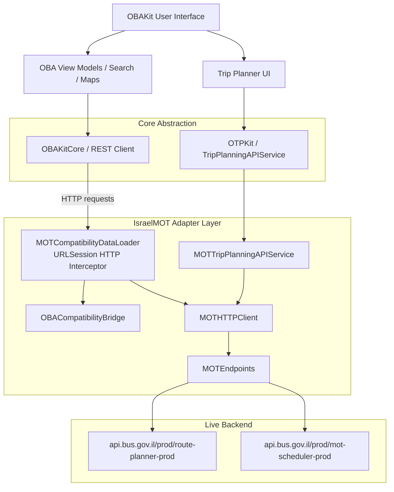
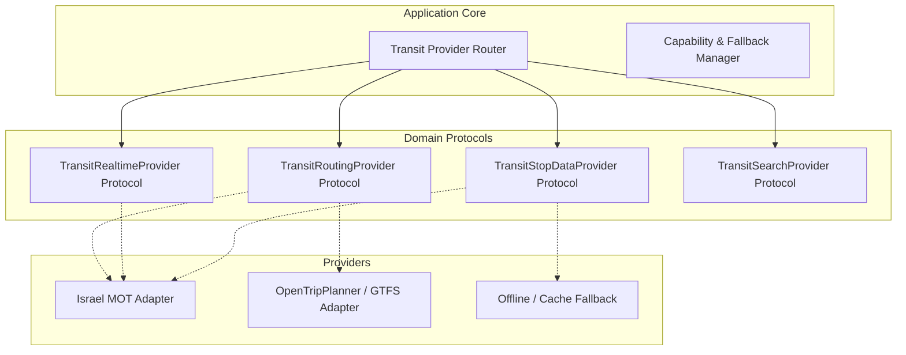

# סקירת ארכיטקטורת ספקים ומוכנות להרחבה — Provider Architecture Review
**תאריך:** 18 באוקטובר 2026  
**מאגר:** [onebusaway-ios](file:///c:/Users/DAVID/Code/onebusaway-ios)  
**מודולים נבדקים:** `IsraelMOT`, `OBAKit`, `OBAKitCore`, `OTPKit`

---

## 1. תמונת מצב נוכחית (Current Architecture)

ארכיטקטורת השילוב הישראלי בנויה כמודול עצמאי (`IsraelMOT`) המגשר בין ממשקי הליבה של האפליקציה (`OBAKit` ו-`OTPKit`) לבין שרתי משרד התחבורה.



### מאפייני המימוש הקיים:
1. **יירוט ברמת הרשת (Network Interception):** `MOTCompatibilityDataLoader` משמש כ-`URLDataLoader` עבור `OBAKit`. כשאפליקציית OneBusAway מבצעת קריאות REST קלאסיות של OneBusAway (לדוגמה `/api/where/stop/mot:stop:2899.json`), המתאם מיירט את הבקשה, פונה לשרת משרד התחבורה, ממפה את ה-DTO לתשובת JSON במבנה של OneBusAway REST, ומחזיר אותה ל-`OBAKit`.
2. **התאמת תכנון מסלול (OTPKit Adapter):** `MOTTripPlanningAPIService` מממש את הפרוטוקול `TripPlanningAPIService` של `OTPKit`, ומתרגם את הבקשה ישירות למבנה של `RoutePlanning/GetRoutes`.
3. **מודלי תחום וחוזים (Contracts):** קיימת שכבת חוזים התחלתית תחת [IsraelMOT/Contracts/](file:///c:/Users/DAVID/Code/onebusaway-ios/IsraelMOT/Contracts/), אך היא כבולה לשמות ספציפיים של משרד התחבורה (`MOTStopCode`, `MOTRouteID`, `MOTFeatureCapabilities`).

---

## 2. האם ניתן להוסיף ספק נוסף באמצעות מתאם בלבד?

### תשובה קצרה: **כן, אך נדרש Refactoring קל בשכבת המזהים והיכולות.**

### החסמים הקיימים כיום להוספת ספק נוסף:
1. **כבילה למזהים נומריים של משרד התחבורה:**
   - ב-[Identifiers.swift](file:///c:/Users/DAVID/Code/onebusaway-ios/IsraelMOT/Contracts/Identifiers.swift), מוגדר `public struct MOTStopCode: RawRepresentable { public let rawValue: Int }`.
   - ספקי תחבורה אחרים (כגון OpenTripPlanner, Google Transit, Moovit, או Citymapper) משתמשים במזהי תחנות אלפא-נומריים מחרוזתיים (כמו `"STOP_TA_1029"` או `"gtfs:12345"`). המבנה הנוכחי נכשל בפיענוח מזהים שאינם ספרות בלבד.
2. **ניהול יכולות ספק (Capabilities):**
   - ה-Enum הקיים `MOTFeatureCapabilities` בודק יכולות ספציפיות של משרד התחבורה. אם יתווסף ספק חיצוני, נדרשת יכולת דינמית לדעת אילו שירותים נתמכים על ידו (למשל: ספק א' תומך בתכנון מסלול, ספק ב' מספק מיקומי GPS חיים).
3. **הצמדה קשיחה ב-DataLoader:**
   - ה-`MOTCompatibilityDataLoader` מכיל קוד בדיקה ישיר מול `api.bus.gov.il`. ספק חדש יחייב החלפה של ה-Loader או פיצולו ל-Chain of Responsibility.

---

## 3. ארכיטקטורה מוצעת מרובת ספקים (Multi-Provider Architecture)

כדי לאפשר שילוב ספקים שונים בצורה חלקה ומודולרית (למשל: משרד התחבורה כספק ראשי, לצד ספק OpenTripPlanner מקומי או גיבוי מבוסס GTFS סטטי), מומלץ המבנה הבא:



### עקרונות התכנון המומלצים:

### 3.1 מזהי תחבורה אחידים (Universal Transit Identifiers)
הפיכת ה-ID ממספר שלם למזהה מורכב גמיש:
```swift
public struct TransitStopID: Hashable, Codable, Sendable {
    public let provider: String      // "mot", "otp", "gtfs"
    public let id: String            // "2899", "STOP-102"
    public let displayCode: String   // "2899" (המספר שמוצג למשתמש על השילוט)
}
```

### 3.2 מטריצת יכולות דינמית (Dynamic Capability Matrix)
כל מתאם יצהיר על סל היכולות הנתמכות:
```swift
public struct ProviderCapabilities: OptionSet, Sendable {
    public let rawValue: Int
    public static let tripPlanning = ProviderCapabilities(rawValue: 1 << 0)
    public static let realtimeArrivals = ProviderCapabilities(rawValue: 1 << 1)
    public static let realtimeVehicleGPS = ProviderCapabilities(rawValue: 1 << 2)
    public static let boundingBoxMapStops = ProviderCapabilities(rawValue: 1 << 3)
    public static let fullRouteSchedules = ProviderCapabilities(rawValue: 1 << 4)
    public static let serviceAlerts = ProviderCapabilities(rawValue: 1 << 5)
}
```

### 3.3 מנגנון מיתוג ונסיגה (Fallback & Provider Selection)
- **תכנון מסלול:** קריאה ל-MOT. אם השרת משיב בשגיאת 5xx או חסימת רשת, נסיגה אוטומטית (Fallback) ל-OpenTripPlanner או מנוע מקומי.
- **זמני הגעה בזמן אמת:** קריאה ישירה לשרת הרשמי (SIRI-SM / MOT).
- **תחנות במפה:** שימוש במאגר מקומי מבוסס GTFS / SQLite עם רענון רקע, כדי לחסוך פניות לרשת ולהימנע ממגבלת 10 התחנות.

---

## 4. סיכום מוכנות
התשתית שנבנתה ב-`IsraelMOT` מהווה בסיס מצוין, ומפרידה בהצלחה את קוד ה-UI משרתי הממשלה. ביצוע ה-Refactoring המוצע יאפשר הרחבה של האפליקציה לכל ספק נוסף בעתיד ללא פגיעה בממשק המשתמש.
